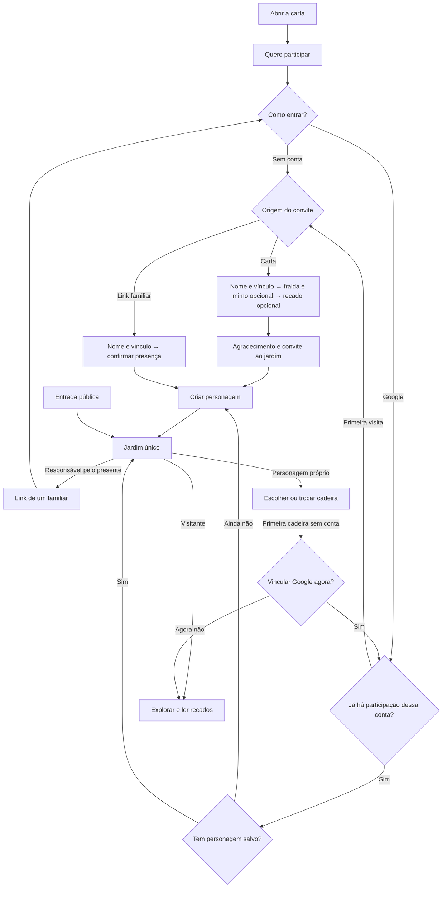
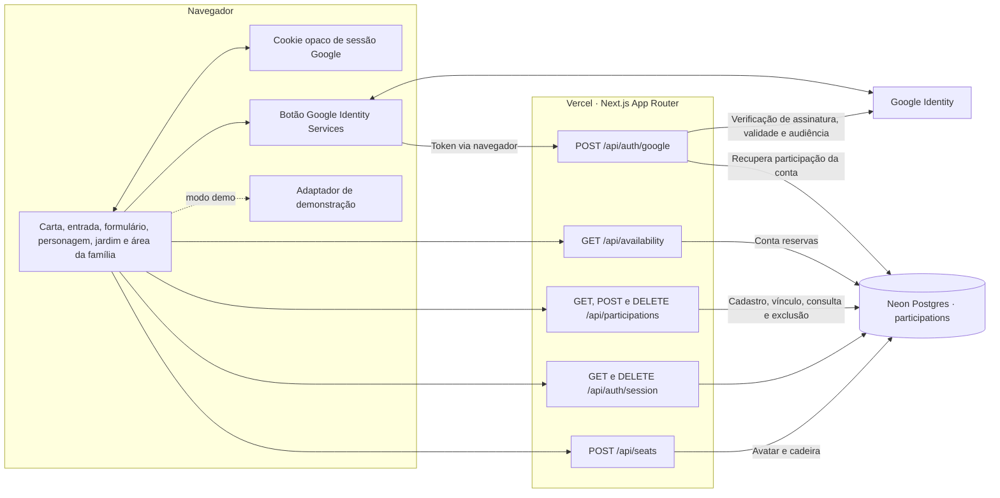

# Como participar do chá do Estêvão

## Percurso do convidado

## Entradas, retornos e exceções

| Situação | O que deve acontecer |
| --- | --- |
| Abrir ou fechar a carta | O selo revela o convite. Fechar a carta retorna ao envelope. |
| Quero participar | Abre a escolha entre Google e continuar sem conta. Voltar retorna ao convite. |
| Continuar sem conta pela carta | Informar nome e vínculo, contato opcional, escolher uma fralda, acrescentar um mimo se quiser e escrever um recado opcional. Voltar entre etapas preserva as respostas. Confirmar reserva os itens. |
| Abrir um link familiar | A escolha de entrada mantém o vínculo com quem convidou. Um novo acompanhante informa os dados pessoais e vai direto para o personagem. Cada acompanhante tem cadastro e cadeira próprios. |
| Primeira entrada pelo Google | A conta fornece uma sugestão de nome editável. O formulário segue a origem do convite. O login sozinho não reserva presente nem cadeira. |
| Entrar outra vez com a mesma conta, inclusive em outro aparelho | Recupera a participação existente. Com personagem salvo, abre o jardim. Sem personagem, retoma a criação. Um link familiar também respeita esse cadastro anterior. Para cadastrar um filho separado, usar outra conta ou continuar sem conta. |
| Fechar a janela do Google, perder conexão ou ter o token recusado | A escolha de entrada continua disponível. É possível tentar outra vez ou continuar sem conta. Se a integração estiver sem configuração, a tela indica indisponibilidade. |
| Voltar com sessão Google ativa | O servidor identifica a participação. Nome, personagem e cadeira vêm do banco. É possível editar o visual ou mudar a cadeira. |
| Continuar sem conta | O cadastro e os presentes ficam no banco. A credencial temporária fica apenas na memória da visita. Sair ou recarregar encerra o acesso do visitante ao personagem. |
| Vincular após sentar | O botão Google na confirmação associa a conta à mesma participação, preservando presente, acompanhantes e cadeira. Se a conta já possui outra participação, o sistema informa o conflito. |
| Trocar de aparelho ou sair da conta | Entrar novamente com a mesma conta recupera o perfil vinculado. Sem sessão, o jardim público é somente para visita. |
| Presente indisponível ao confirmar | A API recusa a reserva, atualiza as quantidades na tela e permite voltar à etapa de presentes e trocar a escolha. Reenviar uma confirmação com o mesmo recibo preserva a reserva original. |
| Link familiar inválido ou responsável removido | A confirmação é recusada. Pedir um novo link ao responsável ou participar pelo convite principal. Acompanhantes já cadastrados conservam seus lugares. |
| Sair depois de confirmar a presença | O cadastro e a reserva já estão salvos. Quem entrou com Google pode retomar a criação depois. Quem entrou sem conta deve terminar o boneco nesta visita. Sair antes de confirmar o formulário descarta o preenchimento ao recarregar. |
| Criar ou editar o personagem | Escolher aparência, girar a prévia ou sortear um visual. Confirmar salva o boneco e abre o jardim. Editar um personagem já sentado conserva a cadeira. |
| Visitar diretamente o jardim | Todos podem explorar, ajustar o zoom até 500% e abrir uma cadeira ocupada para ver o convidado e seu recado. Os controles de edição e cadeira dependem de um personagem próprio reconhecido. |
| Escolher ou mudar de cadeira | Selecionar um lugar livre mostra apenas um boneco na prévia. Confirmar grava a escolha. Em uma mudança, a cadeira anterior continua reservada até a confirmação da nova. Se outra pessoa ocupar o lugar primeiro, o mapa é atualizado para escolher outra cadeira. |
| Convidar a família | A pessoa que reservou a fralda gera um link reutilizável. Pode copiá-lo manualmente se o navegador bloquear a área de transferência. O link permite registrar acompanhantes. |
| Meu perfil | Quem entrou com Google acessa o perfil pelo convite ou pelo jardim. Pode alterar nome, vínculo, contato privado e recado público, revisar os presentes e abrir o criador ou a troca de cadeira. Acompanhantes continuam sem reserva de presente. |
| Trocar presentes | A troca só é confirmada quando há estoque para toda a nova reserva. O item anterior é liberado na mesma transação. Uma reserva já feita pode ser mantida mesmo que o item esteja esgotado ou arquivado. |
| Administrar presentes | Na área da família, a aba Lista de presentes permite cadastrar fraldas e mimos, definir marcas e quantidade, editar ou arquivar. A lista mostra reservas e disponibilidade. A aba Convidados reúne as participações. |
| Área da família | A senha abre a lista com dados privados, vínculo, reservas e cadeiras. A família pode atualizar a lista, consultar detalhes, apagar uma participação após confirmação, visitar o jardim público ou sair. Senha recusada mantém o formulário aberto. |
| Créditos | O criador oferece os créditos dos sprites em uma nova aba. A edição permanece na aba original. |
| Demonstração | Usa convidados fictícios e dados locais. Permite testar formulários, familiares e cadeiras no mesmo navegador. Recomeçar teste limpa os dados. O Google e o banco real ficam fora desse modo. |
| Movimento reduzido | As transições de navegação e a animação de entrada das etapas respeitam a preferência de movimento reduzido. |

## Arquitetura

O servidor verifica a identidade Google e associa a conta ao campo único `google_owner` da participação. As sessões ficam em `garden_sessions`. O navegador recebe um cookie HttpOnly que identifica a sessão. Sem conta, o navegador transporta uma credencial temporária apenas em memória durante a primeira visita. O servidor autoriza a criação do personagem e a primeira cadeira, e pode vincular essa mesma linha a uma conta Google após a confirmação. A administração continua protegida pela senha da família.

O vínculo familiar fica na coluna `sponsor_id`. O cadastro valida a prova do convite, serializa as reservas e confere o estoque em uma transação. O banco impede que duas pessoas ocupem a mesma cadeira. O jardim público recebe nome, recado, avatar e lugar. Contato, parentesco e presentes são consultados pela área da família com senha.

### Ativação do Google

Configure um cliente OAuth do tipo **Aplicativo da Web** no Google Cloud e autorize a origem JavaScript `https://char-fralda.vercel.app`. Para desenvolvimento, autorize também a origem local usada. Configure o ID público em `NEXT_PUBLIC_GOOGLE_CLIENT_ID` e mantenha uma chave aleatória estável de pelo menos 32 caracteres em `GOOGLE_PARTICIPATION_KEY` no servidor. Faça novo build após configurar o ID público. Alterar a chave muda a identificação das participações Google e exige uma estratégia de migração. [Configuração oficial do Google](https://developers.google.com/identity/gsi/web/guides/get-google-api-clientid)
